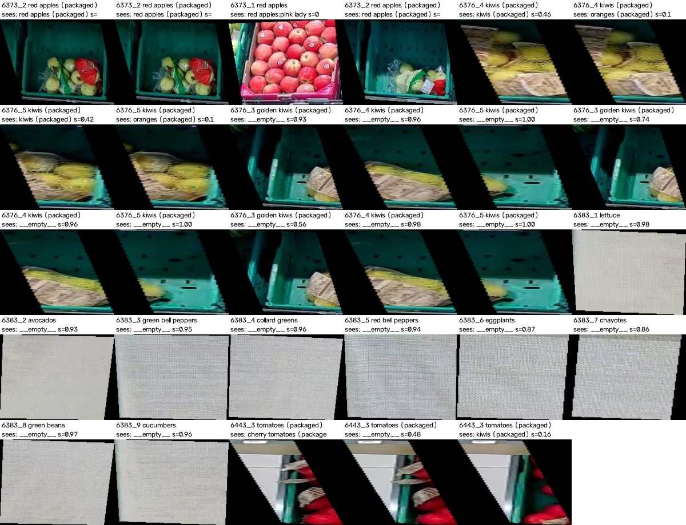
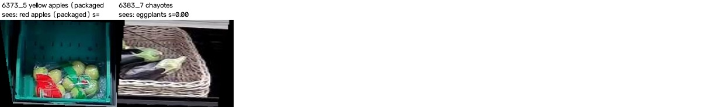
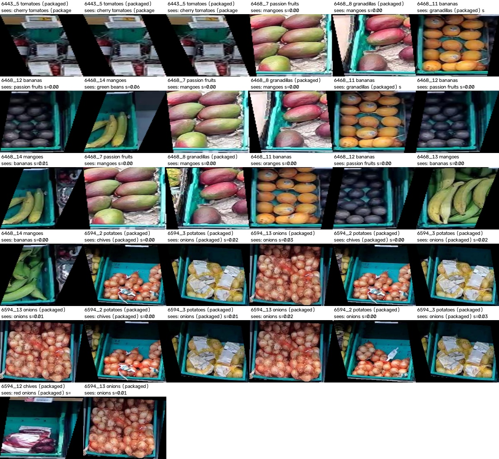

# Review: `dinov2:classifier+gsd:images` (quick_dinov2_variety)

| Camera | Labelled | Correct | Wrong products caught | Missed | False alarms |
|---|---|---|---|---|---|
| 6215 | 120 | 120 | 24 | 0 | 0 |
| 6371 | 117 | 117 | 0 | 0 | 0 |
| 6373 | 118 | 113 | 12 | 4 | 1 |
| 6376 | 207 | 194 | 35 | 13 | 0 |
| 6383 | 117 | 107 | 0 | 9 | 1 |
| 6385 | 27 | 27 | 0 | 0 | 0 |
| 6386 | 18 | 18 | 0 | 0 | 0 |
| 6443 | 39 | 36 | 0 | 3 | 0 |
| 6462 | 27 | 27 | 0 | 0 | 0 |
| 6468 | 48 | 48 | 0 | 0 | 0 |
| 6491 | 30 | 30 | 0 | 0 | 0 |
| 6591 | 30 | 30 | 0 | 0 | 0 |
| 6594 | 39 | 39 | 0 | 0 | 0 |
| 6781 | 30 | 30 | 0 | 0 | 0 |
| **all** | 967 | 936 | 71 | 29 | 2 |

## Missed wrong products: 29

6376_4 ×5, 6376_5 ×5, 6373_2 ×3, 6376_3 ×3, 6443_3 ×3, 6373_1 ×1, 6383_1 ×1, 6383_2 ×1, 6383_3 ×1, 6383_4 ×1, 6383_5 ×1, 6383_6 ×1, 6383_7 ×1, 6383_8 ×1, 6383_9 ×1

## False alarms: 2

6373_5 ×1, 6383_7 ×1

## Flagged on unlabelled areas (final model): 32

6594_2 ×4, 6594_3 ×4, 6594_13 ×4, 6443_5 ×3, 6468_7 ×3, 6468_8 ×3, 6468_11 ×3, 6468_12 ×3, 6468_14 ×3, 6468_13 ×1, 6594_12 ×1
